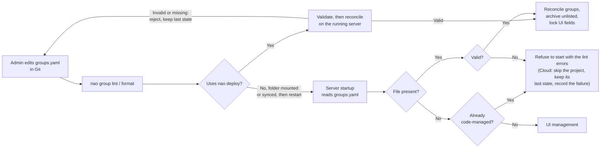

# Groups as Code

Status: decided, next steps for this PR
Related: [#1809](https://github.com/getnao/nao/issues/1809), [#2346](https://github.com/getnao/nao/pull/2346) (column policies)

## Why

Customers want to manage user groups in YAML. This is the first step of a broader change: every nao setting (groups, budgets, protected tables, …) will eventually be defined in YAML files in the project. `groups.yaml` sets the conventions the other files will follow.

## Decisions

- **File**: `groups.yaml` at the project root, next to `nao_config.yaml`.
- **Naming**: every key and enum value is snake_case (`story_creation`, not `storyCreation`).
- **Direction**: UI → code only. The UI never writes back to the file, and there is no way back to UI management in this PR.
- **Activation**: the first valid `groups.yaml` switches the project to code management. There is no UI toggle. The UI keeps a **Download YAML** button that exports the current state as a starting file.
- **Read-only**: everything defined in the file becomes read-only in the UI and is rejected by the mutation APIs. Anything the file does not define keeps its current ownership.
- **Invalid file blocks**: an invalid file stops the server at startup and is rejected by `nao deploy`. On nao Cloud, where one server hosts many customers, startup skips that project instead: it keeps its last applied state, and the failure is logged and shown as "Last attempt failed" in the project's user group settings. Making minor issues non-blocking warnings is a later topic.
- **Missing file blocks too**: once a project is code-managed, a missing `groups.yaml` is treated like an invalid file. Customers recover by restoring an earlier version from Git. Deleting the file never falls back to UI management.
- **When changes apply**: `nao deploy` applies the file to the running server without a restart. Customers who mount or sync the project folder without `nao deploy` get changes on the next startup.
- **Unlisted groups**: a custom group that exists in the database but not in the file is archived. Its access is revoked and its records are kept.

## File shape

```yaml
groups: # list of groups, each identified by an id
    - id: default | all_users | <custom id> # all_users is required
      name: Finance # custom groups only, shown in the UI, defaults to the id
      list_of_emails: [] # custom groups only
      sso_groups: {} # custom groups only
      capabilities: {} # features, UI settings, sharing, MCP, skills
      access: {} # context tree: databases and files
      policies: {} # rows and columns
protected_tables: {} # reserved, moves to its own file later
budget: {} # reserved, moves to its own file later
```

The complete annotated example is in the [appendix](#appendix-complete-example).

Key rules:

- `groups` is the first top-level key. `protected_tables` and `budget` sit beside it because each will move to its own file later.
- There is no `version` key. The file has no older shape to tell apart, and `nao group format` removes the key from files written before this change.
- `id` replaces `key`. It is the stable identifier and the value used in `share_targets.group_ids`. It must be unique and snake_case. Changing an id archives the old group and creates a new one.
- `name` is the label shown in the UI. It is optional and defaults to the id, must be unique, and can change freely without affecting the group's identity. `All Users` is reserved, and `default` and `all_users` cannot declare a name.
- `list_of_emails` replaces `members`. An email with no matching project user yet stays pending and is activated when that user gets project access. The file never sends invitations.
- `default` and `all_users` are entries in `groups` with reserved ids. `default` is optional and only provides values for other groups to inherit; it has no members. `all_users` is required, so a file without it is invalid. It always contains every project user, so it cannot declare `list_of_emails` or `sso_groups`. Its settings can still be omitted and inherited.
- Docs access and files access are merged into `access.files`, with paths relative to the project root.
- MCP and skills access are not part of the context tree (`access`). They live under `capabilities` and are still fully managed by the file.
- `policies.rows` holds the current row policies and grants access against the tables registered in the Row security settings. `policies.columns` is reserved for the column policies from [#2346](https://github.com/getnao/nao/pull/2346): an empty list is accepted and anything else is rejected until that PR lands.

### Inheritance

Settings resolve in this order: nao's hidden defaults, then the `default` group, then the specific group (`all_users` included). Each leaf setting, such as `access.files` or `capabilities.skills`, replaces the inherited value as a whole. Lists are never merged. Inheritance is resolved before validation and before diffing, so two files that resolve to the same settings are treated as identical.

### SSO

A user's membership in a group is the union of:

- the group's `list_of_emails`, and
- users whose identity provider groups match the group's `sso_groups`. This is re-evaluated at every login.

For example, a new user who joins the `okta-finance` group in Okta lands in `finance` on their first login, not just in `all_users`.

## Flow



## CLI

Some customers never run `nao deploy`, so validation must also work without it:

- `nao group lint` works offline. It checks the schema and the references inside the local project: that files exist, tables exist in the synced databases, and `group_ids` and skills resolve.
- `nao group format` rewrites the file with a standard key order and indentation. It also fixes mechanical issues such as camelCase values, old key names (`key`, `members`, `docs_access`), a leftover `version`, or a group with a `name` but no `id`.
- `nao group diff` shows what changed in the file since a Git commit (`--ref`, default `HEAD`), group by group and setting by setting. Both versions are resolved first, so only real changes show. `--exit-code` exits with 1 when there are changes, for CI.
- `nao groups` is an alias of `nao group`.

Both commands and server startup use the same rules, so a file that passes `lint` also passes at startup. Checks that need the database, such as licenses, email matching, and row policies against the protected tables, only run on the server.

The commands are implemented once in TypeScript, as `nao-chat-server groups lint|format|diff`. The Python CLI calls the server binary already bundled in the `nao-core` package, with an in-memory database, so the rules cannot drift between the CLI and the server.

## Impact on the branch

- **Remove**: the UI toggle between UI and code management, the enablement preview, the disable flow, and the related mutations and tests.
- **Keep and adapt to the new schema**: the parser and validator, the YAML export, deploy-time reconciliation, archival, pending emails, write guards, and activity audit.
- **Change**: the project's management mode is set automatically by the first successful apply instead of a toggle. It is kept so a missing file can be detected. Reconciliation also runs at server startup.

## Out of scope (follow-up PRs)

- Returning from code to UI management, and writing UI edits back to the file.
- Non-blocking warnings for minor issues.
- Applying `protected_tables` (today's row and column security registries) and `budget`, including group budgets. Their keys are reserved in this PR, and they stay editable in the UI until their own PRs.
- Splitting settings across several YAML files.

## Open questions

- Git-connected projects on nao Cloud ([#2288](https://github.com/getnao/nao/pull/2288)) update context without `nao deploy`. Should that sync apply `groups.yaml` the same way deploy does?

## Appendix: complete example

```yaml
groups:
    # Optional. Overrides nao's hidden defaults for every other group, all_users included.
    # It has no members and is never shown as a group in the UI.
    - id: default
      capabilities:
          features: [] # story_creation | custom_story_creation | automation_creation
          tool_call_density:
              default_density: detailed # compact | detailed
              can_change: true
          show_all_settings: false
          advanced_context_explorer: false # context admins use the advanced File Explorer
          project_sharing: inherit # inherit | allowed | blocked
          share_targets:
              include_own_group: true
              group_ids: []
          mcp:
              mode: restricted # all | restricted
              grants: []
          skills:
              mode: restricted # all | restricted
              allowed: []
              preloaded: [] # always loaded into the agent, up to the preloaded-skill limit
      access:
          databases:
              mode: restricted # all | restricted
              strict: false # block SQL on tables outside the user's combined group access
              grants: []
              patterns: []
          files:
              mode: restricted # all | restricted
              grants: []
      policies:
          rows: []
          columns: []

    # Required. Every project user is a member; list_of_emails and sso_groups are rejected.
    - id: all_users
      capabilities:
          features: [story_creation]
          show_all_settings: true
          mcp:
              mode: all
          skills:
              mode: all
              preloaded: [company_glossary]
      access:
          databases:
              mode: all
              strict: false
          files:
              mode: all

    - id: finance
      name: Finance
      list_of_emails:
          - alice@example.com
          - bob@example.com # pending until bob gets project access
      sso_groups:
          oidc: [okta-finance] # group names sent in the OIDC groups claim
          microsoft: [6f1c2e4a-0b7d-4c1e-9a3f-2d5b8e7c1a90] # Entra ID group object IDs
          default_project_role: user # admin | user | viewer | context_admin, for users provisioned through these groups
      capabilities:
          features: [story_creation, custom_story_creation, automation_creation]
          tool_call_density:
              default_density: compact
              can_change: false
          project_sharing: allowed
          share_targets:
              include_own_group: true
              group_ids: [leadership] # must exist, cannot reference itself
          mcp:
              mode: restricted
              grants:
                  - kind: server # every tool of the server
                    server: github
                  - kind: tool # a single tool
                    server: slack
                    tool: post_message
          skills:
              mode: restricted
              allowed: [revenue_analysis, forecasting]
              preloaded: [revenue_analysis] # must also be allowed
      access:
          databases:
              mode: restricted
              strict: true
              grants:
                  - kind: schema
                    database_type: postgres
                    database: warehouse
                    schema: finance
                  - kind: table
                    database_type: snowflake
                    database: analytics
                    schema: core
                    table: customers
              patterns:
                  - finance_* # no dot: every table in matching schemas
                  - core.revenue_* # schema.table glob
          files:
              mode: restricted
              grants:
                  - kind: folder
                    path: docs/finance
                  - kind: file
                    path: semantics/revenue.yaml
      policies:
          rows:
              - database_type: postgres # guided predicate
                database: warehouse
                schema: finance
                table: invoices
                access: predicate
                mode: guided
                combinator: and # and | or
                conditions: # 1 to 100 conditions
                    - column: region
                      operator: is_one_of # equals | does_not_equal | greater_than | greater_than_or_equal
                      values: [EMEA, APAC] # | less_than | less_than_or_equal | is_one_of | is_not_one_of
                    - column: deleted_at # | is_null | is_not_null
                      operator: is_null
              - database_type: postgres # raw SQL predicate
                database: warehouse
                schema: finance
                table: payments
                access: predicate
                mode: sql
                predicate: WHERE amount < 10000 # must start with WHERE
              - database_type: postgres # no row restriction
                database: warehouse
                schema: finance
                table: budgets
                access: full
          columns: [] # reserved and must stay empty until #2346 lands, then for example:
          # - database_type: postgres # reveals columns hidden in protected_tables
          #   database: warehouse
          #   schema: finance
          #   table: employees
          #   granted_columns: [salary]

    - id: leadership
      name: Leadership
      list_of_emails: [ceo@example.com]
      capabilities:
          show_all_settings: true
          project_sharing: blocked
      access:
          databases:
              mode: all
              strict: true

# Reserved. Parsed and applied in a follow-up PR; still edited in the UI until then.
protected_tables:
    rows: # tables that need a row policy before a group can query them
        - database_type: postgres
          database: warehouse
          schema: finance
          table: invoices
          constraint_columns: [region, deleted_at]
    columns: # columns hidden unless a group's policies.columns grants them
        - database_type: postgres
          database: warehouse
          schema: finance
          table: employees
          restricted_columns: [salary, bank_account]

# Reserved. Parsed and applied in a follow-up PR; still edited in the UI until then.
budget:
    providers:
        - provider: anthropic
          limit_usd: 5000
          per_user_limit_usd: 200
          period: month # day | week | month
    members:
        period: month # week | month | year
        default_limit_usd: 50
        overrides:
            - email: alice@example.com
              limit_usd: 150
    groups:
        - id: finance
          limit_usd: 250
```
