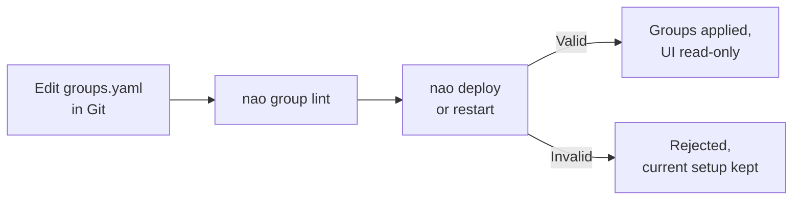

# Managing nao user groups in YAML: proposed plan

We are adding a way to define nao user groups in a YAML file kept in your project repository, instead of configuring them in the UI. This is the first step toward defining most nao settings in code. We would love your feedback before we build it.

## How it will work

- You add a `groups.yaml` file at the root of your nao project, next to `nao_config.yaml`.
- Once nao loads a valid file, the file becomes the source of truth. Everything it defines is read-only in the nao UI.
- Changes go live when you run `nao deploy`, or on the next restart if you mount or sync the project folder yourself.
- Two new commands check the file before you ship it:
    - `nao group lint` reports errors.
    - `nao group format` cleans up the file and fixes simple mistakes.
    - `nao groups` works too.
- An invalid or missing file is a blocking error. A bad deploy is rejected and the current setup keeps working. Because the file lives in Git, you can always roll back to a previous version.
- To get started, a **Download YAML** button in the UI exports your current groups as a ready-to-use file.



## Complete example

```yaml
groups:
    # Optional. Overrides nao's built-in defaults for every other group, all_users included.
    # It has no members and is never shown as a group in the UI.
    - id: default
      capabilities:
          features: [] # story_creation | custom_story_creation | automation_creation
          tool_call_density:
              default_density: detailed # compact | detailed
              can_change: true
          show_all_settings: false
          advanced_context_explorer: false # context admins use the advanced File Explorer
          project_sharing: inherit # inherit | allowed | blocked
          share_targets:
              include_own_group: true
              group_ids: []
          mcp:
              mode: restricted # all | restricted
              grants: []
          skills:
              mode: restricted # all | restricted
              allowed: []
              preloaded: [] # always loaded into the agent, up to the preloaded-skill limit
      access:
          databases:
              mode: restricted # all | restricted
              strict: false # block SQL on tables outside the user's combined group access
              grants: []
              patterns: []
          files:
              mode: restricted # all | restricted
              grants: []
      policies:
          rows: []
          columns: []

    # Required. Every project user is a member; list_of_emails and sso_groups are rejected.
    - id: all_users
      capabilities:
          features: [story_creation]
          show_all_settings: true
          mcp:
              mode: all
          skills:
              mode: all
              preloaded: [company_glossary]
      access:
          databases:
              mode: all
              strict: false
          files:
              mode: all

    - id: finance
      name: Finance
      list_of_emails:
          - alice@example.com
          - bob@example.com # pending until bob gets project access
      sso_groups:
          oidc: [okta-finance] # group names sent in the OIDC groups claim
          microsoft: [6f1c2e4a-0b7d-4c1e-9a3f-2d5b8e7c1a90] # Entra ID group object IDs
          default_project_role: user # admin | user | viewer | context_admin
      capabilities:
          features: [story_creation, custom_story_creation, automation_creation]
          tool_call_density:
              default_density: compact
              can_change: false
          project_sharing: allowed
          share_targets:
              include_own_group: true
              group_ids: [leadership] # must exist, cannot reference itself
          mcp:
              mode: restricted
              grants:
                  - kind: server # every tool of the server
                    server: github
                  - kind: tool # a single tool
                    server: slack
                    tool: post_message
          skills:
              mode: restricted
              allowed: [revenue_analysis, forecasting]
              preloaded: [revenue_analysis] # must also be allowed
      access:
          databases:
              mode: restricted
              strict: true
              grants:
                  - kind: schema
                    database_type: postgres
                    database: warehouse
                    schema: finance
                  - kind: table
                    database_type: snowflake
                    database: analytics
                    schema: core
                    table: customers
              patterns:
                  - finance_* # no dot: every table in matching schemas
                  - core.revenue_* # schema.table glob
          files:
              mode: restricted
              grants:
                  - kind: folder
                    path: docs/finance
                  - kind: file
                    path: semantics/revenue.yaml
      policies:
          rows:
              - database_type: postgres # guided predicate
                database: warehouse
                schema: finance
                table: invoices
                access: predicate
                mode: guided
                combinator: and # and | or
                conditions: # 1 to 100 conditions
                    - column: region
                      operator: is_one_of
                      values: [EMEA, APAC]
                    - column: deleted_at
                      operator: is_null
              - database_type: postgres # raw SQL predicate
                database: warehouse
                schema: finance
                table: payments
                access: predicate
                mode: sql
                predicate: WHERE amount < 10000 # must start with WHERE
              - database_type: postgres # no row restriction
                database: warehouse
                schema: finance
                table: budgets
                access: full
          columns:
              - database_type: postgres # reveals columns hidden in protected_tables
                database: warehouse
                schema: finance
                table: employees
                granted_columns: [salary]

    - id: leadership
      name: Leadership
      list_of_emails: [ceo@example.com]
      capabilities:
          show_all_settings: true
          project_sharing: blocked
      access:
          databases:
              mode: all
              strict: true

# Planned for a later release; these settings stay editable in the UI for now.
protected_tables: {}

# Planned for a later release; these settings stay editable in the UI for now.
budget: {}
```

Each group has:

- **`id`**: a stable snake_case identifier, used to reference the group elsewhere in the file.
- **`name`**: the label shown in the UI. Optional, it defaults to the id and can be renamed freely.
- **`list_of_emails`** and **`sso_groups`**: who is in the group. People in a matching SSO group (for example from Okta or Microsoft Entra ID) are added automatically when they log in.
- **`capabilities`**: features, sharing, MCP servers, and skills.
- **`access`**: which databases and files the group can use.
- **`policies`**: row-level and column-level security.

Settings flow from nao's built-in defaults, to the `default` group, to each specific group. A group only needs to list what it changes.

A group removed from the file loses its access, but its history is kept. Emails of people who have not joined the project yet are kept and take effect when they join. The file never sends invitations.

## Not in this first version

- Editing groups in the UI once the file is in use, or having UI edits written back to the file.
- Sensitive-table and budget settings in YAML. They will move to code in a later release and stay in the UI until then.
- Column policies (`policies.columns`). The example shows where they will go; until column-level security ships, the list must stay empty.
- Lenient handling of minor mistakes. Every error is blocking for now.

## Your feedback

1. Does this cover how you want to manage groups and access?
2. Is your setup ready for a blocking error on an invalid file? Do you run `nao deploy` in your pipeline?
3. Do you rely on SSO groups (Okta, Microsoft Entra ID) to assign people to groups?
4. Which settings would you like to manage in code next: budgets, sensitive tables, or something else?
