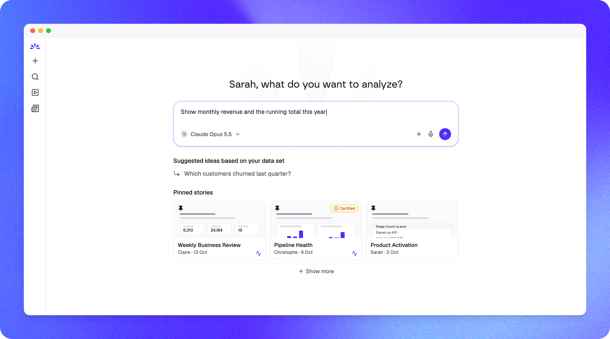

<p align="center">
  <a href="https://getnao.io">
    <picture>
      <source media="(prefers-color-scheme: dark)" srcset=".github/images/Icon_template_IOS.svg" />
      
    </picture>
  </a>
</p>

<h1 align="center">nao</h1>

<h3 align="center">
  The #1 open-source analytics agent
</h3>

<p align="center">
  Your data team owns the context layer. Everyone in the company can build on data.
</p>

<p align="center">
  🌐 <a href="https://getnao.io">Website</a> · 📚 <a href="https://docs.getnao.io">Documentation</a> · ☁️ <a href="https://app.getnao.io/signup">nao Cloud</a> · 💬 <a href="https://join.slack.com/t/naolabs/shared_invite/zt-4080jlm79-nm52x5nZhG2N1ben8zwpiQ">Slack</a>
</p>

<br/>

<p align="center">
  <a href="https://getnao.io">
    
  </a>
</p>

<br/>

## What is nao?

nao is an open-source framework to build, evaluate and deploy analytics agents on top of your existing data stack.

1. **Your data team builds the context** with the `nao-core` CLI: sync your warehouse, dbt, docs and rules into files your agent reads.
2. **nao tests it**: `nao test` scores every context change against the SQL you expect, before it ships.
3. **Everyone in the company uses it**: business users ask questions in plain English from the nao chat, Slack, Teams or any MCP client, and build their own charts and stories.

Context work is what takes an analytics agent from 15% to 85% reliability. nao gives you the framework to do it, and keeps it in your hands.

## Key features

**For data teams**

- 🧱 **Open context builder**: a file-system context for your agent. Data, metadata, dbt, semantic layer, docs, rules, tools, MCPs. No limit, all versioned in Git.
- 🏳️ **Stack agnostic**: works with any warehouse (BigQuery, Snowflake, Databricks, Postgres, Redshift, DuckDB, ClickHouse, Athena, Trino, Fabric...) and any LLM (Claude, GPT, Gemini, Mistral, Bedrock, Ollama...).
- 🧪 **Evaluate offline**: unit test your agent with `nao test` and track accuracy, consistency and cost of every context change.
- 🔭 **Observe online**: replay every conversation, collect user feedback, and turn errors and downvotes into context recommendations opened as pull requests.
- 🤖 **Agent-native setup**: install the nao skills and let Claude Code, Codex or Cursor set up, test and audit your context for you.

**For everyone in the company**

- 💬 **Ask in plain English**: get answers straight away, from the web app, Slack, Teams or your favourite MCP client.
- 📊 **Charts and stories**: build interactive charts, dashboards and live stories directly from a chat.
- 🧊 **Transparent reasoning**: see the SQL, the files the agent read and the sources behind every answer.
- 👍 **Easy feedback**: tell the data team when an answer is right or wrong.

**Secure by design**

- 🔒 **Self-host it** on your own infrastructure, or run it on [nao Cloud](https://app.getnao.io/signup).
- 🔑 **Bring your own LLM key**, with budgets per user and per team (Enterprise).
- 🛡️ **Your SSO and warehouse permissions** (Enterprise): Okta, Microsoft Entra ID or any OIDC, row-level security and identity passthrough. Your data is never used to train models. See our [Trust Center](https://compliance.getnao.io/).

## ⚡️ Quickstart

### Option 1: set it up with your coding agent (recommended)

nao ships [skills](skills/) that teach Claude Code, Codex, Cursor or any skills-compatible agent how to build a nao project end to end: scope the tables, write `nao_config.yaml`, sync, write `RULES.md` and create tests.

**1. Install the nao CLI and the nao skills** in the folder where you want your project:

```bash
pip install nao-core
nao skills add getnao/nao
```

> `nao skills` is a thin wrapper around [`npx skills`](https://github.com/vercel-labs/skills) (Node.js 18+ required). `npx skills add getnao/nao` works too.

**2. Ask your agent to set up nao.** Open Claude Code, Codex or Cursor in that folder and paste:

```text
Set up nao, the open-source analytics agent, on my data: run `pip install nao-core`, then `nao skills add getnao/nao`, then use the setup-context skill to create a nao project on my warehouse. Docs: https://docs.getnao.io/nao-agent/quickstart
```

The agent asks you once for your warehouse, the tables in scope, extra context (dbt repo, docs) and your LLM provider, then runs `nao init`, `nao sync`, and writes your first `RULES.md`.

**3. Launch the chat:**

```bash
nao chat
```

The nao chat opens at `http://localhost:5005`. Start asking questions.

### Option 2: set it up manually with the CLI

- **Step 1**: Install nao-core package

    ```bash
    pip install nao-core
    ```

<br/>

- **Step 2**: Initialize a nao project

    ```bash
    nao init
    ```

    It will ask you:
    - To name your project
    - If you want to connect a database _(optional)_
    - If you want to add a repo in agent context _(optional)_
    - To add an LLM key _(optional)_
    - If you want to setup a Slack connection _(optional)_

    💡 You can skip any optional question and configure them later in your `nao_config.yaml` file.

    This will create:
    - A new folder with your project name
    - An architecture for your context files
    - A `nao_config.yaml` configuration file
    - A `RULES.md` file

<br/>

- **Step 3**: Verify your setup

    cd to the project folder and run:

    ```bash
    nao debug
    ```

<br/>

- **Step 4**: Synchronize your context

    ```bash
    nao sync
    ```

    This will populate your context folder with your context files (data, metadata, repos, etc.)

<br/>

- **Step 5**: Launch the chat and ask questions

    ```bash
    nao chat
    ```

    This will start the nao chat UI. It will open the chat interface in your browser at `http://localhost:5005`.
    From there, you can start asking questions to your agent.

## Evaluation framework

Unit test your agent performance before deploying it to users. First, create a folder `tests/` with questions and expected SQL in yaml.
Then, measure agent's performance on examples with nao test command:

```bash
nao test
```

View results in tests panel:

```bash
nao test server
```

## 🚀 Deploy

- **nao Cloud**: [sign up](https://app.getnao.io/signup) and push your context with `nao deploy`.
- **Self-hosted**: run the Docker image below, or follow the [deployment guide](https://docs.getnao.io/nao-agent/self-hosting/deployment-guide) (for example on Cloud Run with PostgreSQL, or with the [Helm chart](helm/)).
- **Continuous deployment**: the `deploy-context` skill sets up a GitHub Action that runs `nao deploy` on every push to `main`.

### 🐳 Docker

Pull the image from DockerHub:

```bash
docker pull getnao/nao:latest
```

Run nao chat with the example project bundled in the image:

```bash
docker run -d \
  --name nao \
  -p 5005:5005 \
  -e BETTER_AUTH_URL=http://localhost:5005 \
  getnao/nao:latest
```

Run nao chat with your local nao project:

```bash
docker run -d \
  --name nao \
  -p 5005:5005 \
  -e BETTER_AUTH_URL=http://localhost:5005 \
  -v /path/to/your/nao-project:/app/project \
  -e NAO_DEFAULT_PROJECT_PATH=/app/project \
  getnao/nao:latest
```

Access the UI at http://localhost:5005 (or at any URL you configured). See the [DockerHub page](https://hub.docker.com/r/getnao/nao) for more details.

## 🏢 Open source vs Enterprise

The core of nao is open source under Apache 2.0. The [Enterprise license](https://getnao.io/enterprise/) adds the controls large companies need, on the same self-hosted deployment. [nao Cloud](https://app.getnao.io/signup) includes the equivalent features.

| Capability | Open source | Enterprise |
| --- | :---: | :---: |
| Open-source agent, chat UI and every LLM provider | ✅ | ✅ |
| Slack, Teams, WhatsApp, Telegram and Mattermost bots | ✅ | ✅ |
| Self-hosting on your infrastructure | ✅ | ✅ |
| Google, GitHub and GitLab login | ✅ | ✅ |
| User groups | Up to 3 | Unlimited |
| Multiple projects (separate data, context and access) | | ✅ |
| Microsoft Entra ID and OIDC SSO | | ✅ |
| Group mapping from your identity provider | | ✅ |
| Row-level security | | ✅ |
| Warehouse identity passthrough | | ✅ |
| LLM budgets per member and per group | | ✅ |
| White-label branding | | ✅ |
| Priority support and roadmap input | | ✅ |

Yearly license per company. The license is verified offline at startup: your deployment never phones home. The nao team also helps with implementation, context engineering advisory and training. [Talk to us](https://getnao.io/enterprise/).

## Commands

```bash
nao --help
Usage: nao COMMAND

╭─ Commands ───────────────────────────────────────────────────────────────────╮
│ chat            Start the nao chat UI.                                       │
│ debug           Test connectivity to configured databases and LLMs.          │
│ deploy          Deploy project context to a remote nao instance.             │
│ docs            Open nao official documentation in your browser              │
│ init            Initialize a new nao project.                                │
│ login           Log in to nao from your browser.                             │
│ logout          Log out of nao and revoke the stored session.                │
│ migrate         Migrate dashboards from Metabase or Tableau.                 │
│ reset-password  Reset a local nao user's password.                           │
│ skills          Install and manage agent skills via npx skills.              │
│ sync            Sync resources using configured providers.                   │
│ test            Run and explore nao tests.                                   │
│ upgrade         Upgrade nao-core to the latest version.                      │
│ --help (-h)     Display this message and exit.                               │
│ --version       Display application version.                                 │
╰──────────────────────────────────────────────────────────────────────────────╯
```

## 👩🏻‍💻 Development

See [CONTRIBUTING.md](CONTRIBUTING.md) for development setup, commands, and guidelines.

### Start nao locally

Prerequisites:

- nvm
- bun
- uv

Run the following commands:

```
npm run npm:pin
npm install
npm run db:migrate -w apps/backend
```

Create a .env file at the root of the repository and input environment variables

Minimum variables necessary are:

```
BETTER_AUTH_SECRET=#run `openssl rand -base64 32` to generate
# Public URL of your app (used for authentication, trusted origins, and Slack redirects)
BETTER_AUTH_URL=http://localhost:3000

# LLM providers
OPENAI_API_KEY=12345678

NAO_DEFAULT_PROJECT_PATH=#path to example folder
```

Run the following command:

```
npm run dev
```

Go to http://localhost:3000 on your browser

## 📒 Stack

### Backend

- Fastify: https://fastify.dev/docs/latest/
- Drizzle: https://orm.drizzle.team/docs/get-started
- tRPC router: https://trpc.io/docs/server/routers

### Frontend

- tRPC client: https://trpc.io/docs/client/tanstack-react-query/usage
- Tanstack Query: https://tanstack.com/query/latest/docs/framework/react/overview
- Shadcn: https://ui.shadcn.com/docs/components

## ⛹️‍♀️ Join the Community

- Star the repo
- Subscribe to releases (Watch → Custom → Releases)
- Follow us on [LinkedIn](https://www.linkedin.com/company/getnao)
- Join our [Slack](https://join.slack.com/t/naolabs/shared_invite/zt-4080jlm79-nm52x5nZhG2N1ben8zwpiQ)
- Contribute to the repo!

## 🫰🏻 Partners

nao Labs is a proud Y Combinator company!

## 📄 License

nao is licensed under the Apache 2.0 License, except for files marked with `/* @license Enterprise */`, which are under the nao Labs Commercial License. See the [LICENSE](LICENSE) file for details.
