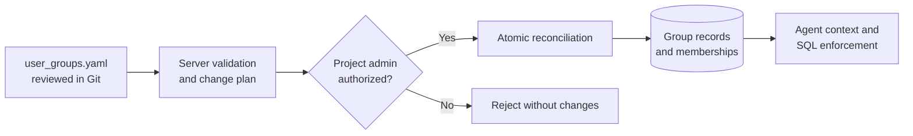
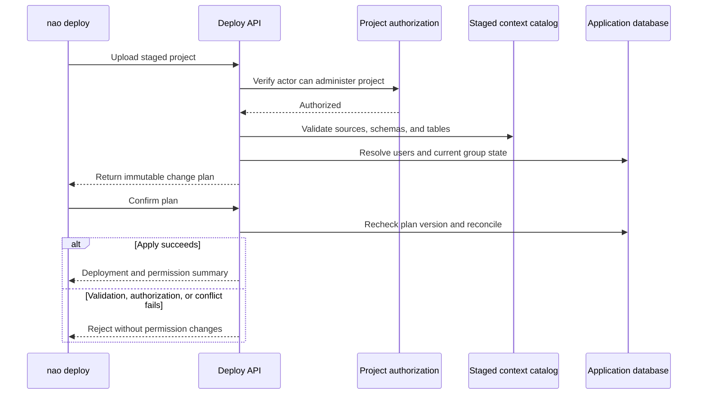
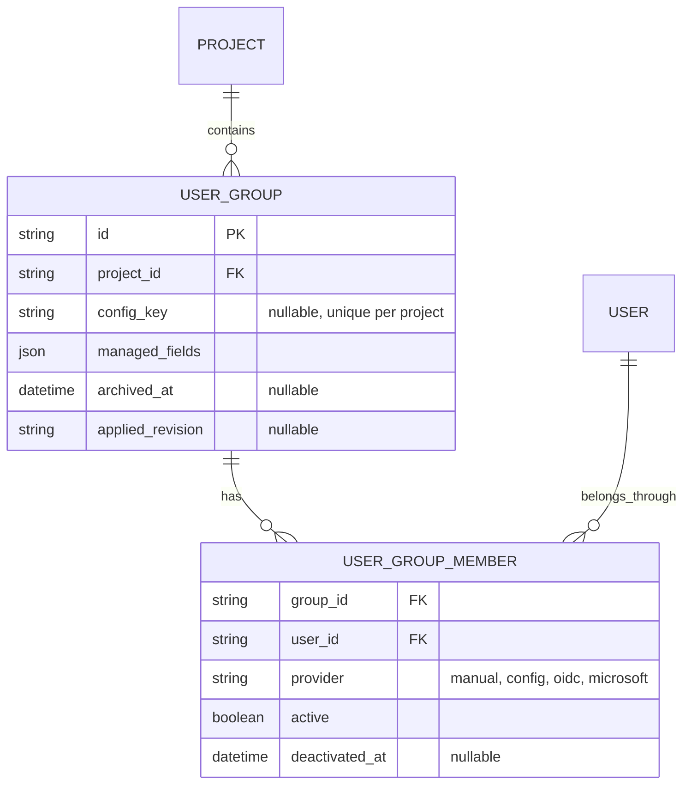
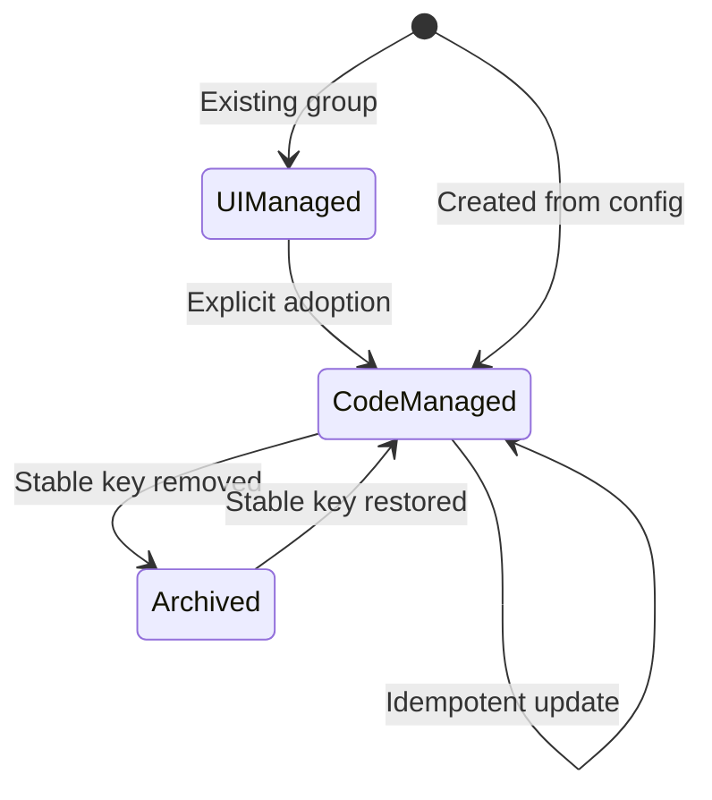

# User Groups as Code

Status: proposed  
Related: [#1809](https://github.com/getnao/nao/issues/1809), [#1800](https://github.com/getnao/nao/issues/1800), [#2129](https://github.com/getnao/nao/issues/2129), [CLS PR #2346](https://github.com/getnao/nao/pull/2346)

## Decision

One versioned `user_groups.yaml` is desired state. `nao deploy` reconciles it. Listed fields are read-only in the UI and authoritative: removing a member or grant revokes that source on the next successful deploy. No file means leave groups untouched.

Phase 1 manages manual membership, source-scoped schema/table/positive-pattern access, strict SQL, and database access on the built-in `All Users` group. Later settings reuse the same file and deploy.



## Deploy

Upload, validate, plan, then apply that exact plan. A context-deploy API key is not enough: the server checks the actor is a project admin. A stale plan fails if state changed. Invalid config or a license the plan needs applies nothing, including context.



Stage and validate context, lock the project, swap the directory, commit group changes, restore the previous directory if the commit fails.

## Rules

- Stable `key`, mutable `name`. Cross-group refs use the key. Adopt an existing UI group explicitly.
- Members are normalized emails of existing users. Unknown or ambiguous email fails. No invites.
- Code owns only declared manual membership. OIDC and Microsoft stay with the identity provider.
- UI shows each membership source: code, UI/manual, OIDC, Microsoft.
- Grants: exact schema (future tables included), exact table, or positive pattern (may match nothing). Scoped to one source. Missing exact source, schema, or table fails. No negative patterns; “schema except table” is a snapshot of current tables.
- `all-users` binds the existing default group and can manage `database_access` only. Never create a second default group.
- Removal archives the group and deactivates that code source. Users, projects, context, and history stay. Another group or SSO can still grant access. The plan separates “grant removed” from “user loses access.”
- Same normalized file twice writes nothing. Unmanaged fields stay UI-editable. The UI does not write back to Git.

## File

```yaml
version: 1

groups:
    - key: all-users
      builtin: all-users
      managed_fields:
          - database_access
      database_access:
          mode: restricted
          strict: true
          grants: []
          patterns: []

    - key: finance
      name: Finance
      managed_fields:
          - members
          - database_access
      members:
          - alice@example.com
          - bob@example.com
      database_access:
          mode: restricted
          strict: true
          grants:
              - source: warehouse
                schema: finance
              - source: warehouse
                schema: shared
                table: exchange_rates
          patterns:
              - source: warehouse
                pattern: reporting.finance_*
```

Empty `All Users` grants plus `strict: true` block every table unless another group grants it.

## Persistence

Extend the existing group and membership tables. Same shape on PostgreSQL and SQLite.



## Lifecycle



## Rollout

1. **#1809.** File above, plan/confirm deploy, UI shows code ownership.
2. **Other settings.** Docs, features, sharing, MCP, skills, export/adopt.
3. **Controls.** SSO mappings, budgets, audit and drift.
4. **RLS and CLS.** Project registries in `security.yaml`, group policy in `user_groups.yaml`, one plan. Build on CLS PR #2346.

Skip per-group files, a repo watcher, auto-invites, and UI-generated pull requests until usage shows they are needed.

## Phase 1 checks

- Missing file preserves current groups. Repeat deploy of the same file writes nothing.
- Invalid config changes neither context nor permissions. A stale plan does not overwrite newer state.
- Only a project admin can apply. Plan lists every managed add/revoke and separates that from effective access.
- Emails resolve or fail clearly. Keys survive renames. Adoption is explicit.
- Managed fields are read-only and labeled. Unmanaged fields stay editable.
- Removing a member, grant, or group revokes that source and keeps users, projects, context, and history.
- Exact selectors match the staged catalog. Patterns are source-scoped. Strict SQL and agent context use the result. SQLite and PostgreSQL match.

## Confirm before building

1. Deleting a member, grant, or group from the file removes only the access that file granted. The user stays, and access from another group or SSO stays.
2. A permission failure rejects the whole deployment.
3. Unknown users fail. They are not invited or left pending.
4. `All Users` database access is configurable in code.
5. Existing UI groups need explicit adoption.
6. #1800 exclusions use a snapshot when future tables must stay excluded.

## Limitations

- YAML changes take effect only after a successful `nao deploy`.
- The UI does not update `user_groups.yaml`.
- Fields managed by YAML are read-only in the UI. Other fields remain editable, but UI changes are not written back to YAML.
- The file can assign only existing project users; it does not create accounts or send invitations.
- Groups-as-code requires its own Enterprise license feature and is enabled per project only when `user_groups.yaml` exists. Without the file, groups remain UI-managed.
- The backend enforces the license; hiding controls in the UI is not sufficient.
- If the license expires, keep the last deployed permissions unchanged and read-only. Never silently remove access or return ownership to the UI.
