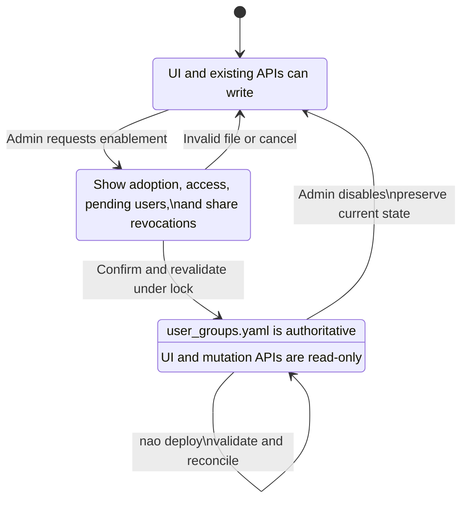
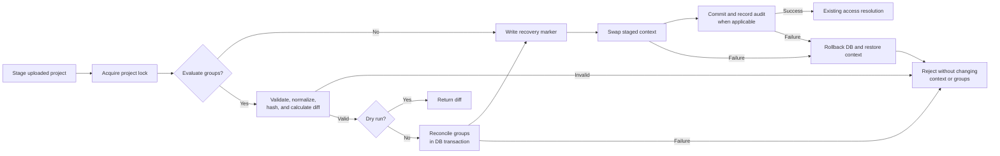
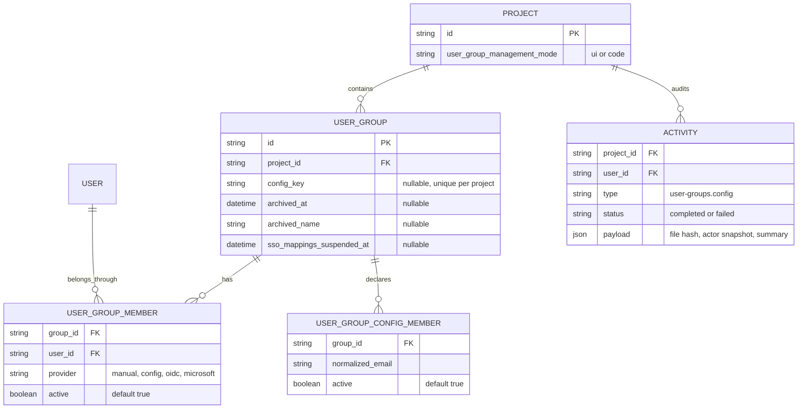

# User Groups as Code

Status: proposed  
Related: [#1809](https://github.com/getnao/nao/issues/1809), [#1800](https://github.com/getnao/nao/issues/1800)

## Decision

Phase 1 adds a project-level user-group management mode:

- `ui` is the default and preserves the current behavior.
- `code` makes `user_groups.yaml` the sole source of truth for every group, membership, and group-level setting.

A project admin explicitly enables code management from the UI after reviewing a calculated diff. Enabling succeeds only when the currently deployed `user_groups.yaml` is valid and adopts every existing custom group. File presence alone never changes the mode.

While code management is enabled:

- The group list, group details, and membership assignments are read-only in the UI.
- All existing group mutation APIs reject writes, even if called outside the UI.
- SSO may authenticate and provision project users, but it cannot choose their groups.
- Every deploy must contain a valid `user_groups.yaml`.
- Outside explicit mode transitions, only `nao deploy` can reconcile group state.
- The API key creator must still be an admin of the target project before a deploy may change group state.

An admin can explicitly return the project to UI management. The last reconciled groups, settings, and memberships are preserved and become editable; the file is ignored until code management is enabled again. Previous SSO group mappings do not resume automatically.



## Ownership

Code management is project-wide, not assigned per group. Mixed UI-managed, SSO-managed, and code-managed custom groups are not supported.

The built-in `All Users` group remains system-owned:

- Its membership continues to mean every project user and cannot be declared manually.
- Its editable settings are required in `user_groups.yaml` and reconciled like other group settings.
- Its name and identity remain fixed.

Project-user invitations and removals remain outside this file. A member email in YAML is a desired assignment:

- If exactly one user with project access has that normalized email, the membership is active.
- If no user with project access has that email yet, the assignment remains pending and produces a warning rather than failing the deploy.
- When SSO or an admin later gives a matching user project access, nao activates the pending membership.
- Ambiguous normalized emails fail validation.
- Removing project access prevents runtime access even if the desired assignment remains in YAML.

SSO authenticates or provisions the project user in this flow; YAML alone selects their groups. Per-group SSO mappings are suspended when code management is enabled. Environment-based OIDC or Microsoft group mappings must be removed before enablement and remain blocked from writing while code mode is active.

Project-level settings that are not owned by a group remain under their existing ownership. The row-security registry stays editable in the UI, but an edit is rejected if it would prune or otherwise change an active YAML-owned group policy. The administrator must remove the affected policy through YAML first.

## Enable and disable

### Enable code management

1. An admin may download the current groups as a valid starter `user_groups.yaml`.
2. The admin deploys a project containing the completed file. In `ui` mode, file presence alone does not change groups.
3. The admin selects “Manage user groups as code” in project settings.
4. The backend verifies that the current admin and license are allowed to enable the feature and that no environment-based group mappings conflict with YAML ownership.
5. The backend reads the currently deployed file and validates its schema, users, context references, settings, licenses, and adoption mapping.
6. Every active custom group must match exactly one file entry by its current name. Archived groups do not need to be adopted.
7. The UI previews created, adopted, changed, archived, and unchanged groups; pending emails; access changes; and shares that will be revoked.
8. After confirmation, the backend acquires the project lock and revalidates the file and diff.
9. In one database transaction, the backend assigns stable keys, reconciles the file, deactivates prior manual and SSO membership rows, suspends group SSO mappings, and changes the project mode to `code`.
10. The backend records the outcome in the audit activity and the UI switches to its read-only state.

An invalid or incomplete file leaves the project in `ui` mode and changes no group records. Pending emails are warnings, not validation errors.

### Return to UI management

1. An admin confirms the mode change.
2. The backend acquires the same project lock used by deploy.
3. The backend preserves every active group and its current settings.
4. For each active config membership, the backend deactivates the config row and reactivates a matching manual row or creates one. It never rewrites the membership provider in place.
5. Pending config assignments are deactivated so they cannot grant access later in `ui` mode.
6. Older manual memberships that are not part of the last reconciled YAML remain inactive.
7. The backend changes the project mode to `ui` in the same transaction and records the transition.

Suspended SSO group mappings do not resume automatically. An admin must explicitly configure them again after returning to UI management. The deployed file remains on disk but has no effect; enabling code management again repeats the full validation and adoption check.

## Export and preview

In `ui` mode, an admin can download a complete YAML representation of the current effective state:

- Existing group names are preserved.
- Candidate stable keys are generated deterministically and made unique.
- Effective manual and SSO memberships are exported as explicit normalized emails.
- `All Users`, feature settings, context access, row policies, sharing, and budgets are included.
- The export never changes database state.

The enablement preview and `nao deploy --dry-run` use the production parser, validation, normalization, and diff logic. A dry run uploads and validates the candidate project but changes neither files nor database state. It reports pending emails, license problems, access changes, archives, reactivations, budget changes, and share revocations.

A preview is advisory rather than an approval token. A real enablement or deploy always recalculates the diff under the project lock, preventing a stale preview from being applied.

## Deploy

Both normal deploy and dry run use the same staged flow:

1. Extract and inspect the uploaded project in a staging directory.
2. Resolve the target project and its management mode.
3. For a code-managed apply or group dry run, verify that the API key creator is still an admin of the target project.
4. Acquire one database-backed project lock shared by deploy, enablement, and disablement.
5. In `code` mode, require and strictly parse `user_groups.yaml`. A group dry run in `ui` mode also requires the file.
6. When group state is being evaluated, validate keys, names, settings, licenses, share-target keys, member emails, context references, and environment mapping conflicts against the staged project.
7. For that group operation, normalize the file, calculate its hash, resolve current and pending users, and calculate the full diff.
8. For a dry run, return the diff and release the lock without writing state.
9. For a code-managed apply, begin the group transaction, reconcile the complete desired state, and prepare the audit summary. A normal `ui`-mode deploy skips group reconciliation.
10. Swap the staged context into place while retaining the previous directory for recovery.
11. Commit any group transaction, record the audit outcome when applicable, and remove the retained directory only after both stores are confirmed.
12. Return the file hash and summary of created, updated, archived, reactivated, pending, and unchanged records.

In `ui` mode, `user_groups.yaml` is stored with the rest of the deployed project but does not change group state. It is validated only when an admin attempts to enable code management.

The filesystem and database cannot share a literal transaction. The deploy coordinator therefore writes a recovery marker before swapping directories. A normal failure rolls back the database and restores the previous directory. If the process crashes between the swap and commit, the marker and retained directory allow the next startup or deploy to finish or restore the operation before serving the project.



## Reconciliation rules

- Each custom group has a stable `key` and mutable `name`.
- Keys are used for cross-group references such as sharing targets.
- Normalized keys must be unique within the project. Names must be unique among active groups.
- Archived groups retain their last display name, while their internal active-name value is released for reuse.
- Member emails are normalized desired assignments. Unknown emails remain pending; ambiguous emails reject the deploy.
- Deploy never sends invitations.
- SSO mappings are not accepted in YAML because no identity provider may choose group membership in code mode.
- Removing a member deactivates its config membership without deleting its record.
- Removing a custom group archives it and revokes its memberships and access without deleting records.
- An empty `groups` list archives every custom group. It does not remove or change `All Users`.
- Restoring the same key reactivates its group. Changing a key creates a new group and archives the old one.
- Deploying the same normalized file twice writes nothing.
- Runtime access is the union of `All Users` and the user's active custom groups.
- Archived groups and inactive memberships grant no access and are omitted from normal UI lists.
- Archival applies to YAML reconciliation in Phase 1. Existing UI deletion behavior remains unchanged; a separate follow-up must unify UI deletion with archival.

### Defaults and normalization

`defaults` is required and contains a complete set of custom-group settings. `all_users` and each custom group inherit omitted fields from it. A supplied field replaces that complete field value; arrays replace rather than merge. This avoids hidden application defaults and ambiguous deep merges.

The parser resolves inheritance before validation, hashing, diffing, or persistence. Two files that normalize to the same complete state are idempotent even if one repeats inherited values.

### Licensing

Enablement and deploy apply the same licenses as the UI:

- A change that introduces or modifies a licensed setting requires its current license.
- An unchanged licensed value does not block an otherwise unrelated context deploy.
- Removing a restriction or licensed setting remains allowed when the corresponding license permits that safety behavior today.
- If a license expires, code mode remains enabled and the last configuration is preserved. New changes requiring the expired license are rejected.
- Existing runtime license behavior still applies, including locking custom groups beyond the free limit without deleting their settings.

### Active-only reads

Adding archive and active flags is insufficient unless every reader honors them. The backend must expose reusable predicates or query helpers for active groups and memberships, then audit every direct reader of `user_group` and `user_group_member`.

Access resolution, shared chats, shared stories, activity audiences, budgets, SSO services, and administrative overviews must all ignore archived groups and inactive memberships. Focused regression tests must prove that removing a YAML membership immediately removes each observable entitlement.

## File

The file must resolve to every group-level setting that remains valid under code ownership. Its strict versioned schema maps snake-case YAML fields to the existing shared user-group types rather than introducing a second access model. SSO mappings are intentionally excluded because the file contains explicit membership.

```yaml
version: 1

defaults:
    features: []
    tool_call_density:
        default_density: detailed
        can_change: true
    show_all_settings: false
    project_sharing: inherit
    share_targets:
        include_own_group: true
        group_keys: []
    preloaded_skills: []
    budget_limit_usd: null
    database_access:
        mode: restricted
        strict: false
        grants: []
        patterns: []
    docs_access:
        mode: restricted
        grants: []
    files_access:
        mode: restricted
        grants: []
    mcp_access:
        mode: restricted
        grants: []
    skills_access:
        mode: restricted
        skills: []
    row_policies:
        version: 1
        policies: []

all_users:
    show_all_settings: true
    database_access:
        mode: all
        strict: false
    docs_access:
        mode: all
    files_access:
        mode: all
    mcp_access:
        mode: all
    skills_access:
        mode: all

groups:
    - key: finance
      name: Finance
      members:
          - alice@example.com
          - bob@example.com
      features:
          - storyCreation
      budget_limit_usd: 250
      database_access:
          mode: restricted
          strict: true
          grants:
              - kind: schema
                database_type: postgres
                database: warehouse
                schema: finance
          patterns: []
```

The final parser schema must cover the complete existing values for features, tool-call density, settings visibility, project sharing and targets, preloaded skills, budgets, database/docs/files/MCP/skills access, and row policies. Unknown fields and unsupported values fail validation rather than being ignored. The export, preview, apply, and administrator guide examples all use this same parser.

## Persistence

Keep PostgreSQL and SQLite synchronized in one logical migration. Before generating it, check whether the branch already contains a migration and update that migration set instead of creating a second one.

The existing membership table cannot represent an email before a user exists because it requires a user foreign key. Add one config-assignment table for desired normalized emails; use the existing membership table only for resolved users.



Active resolved file memberships use `provider: config`. The config assignment remains active whether its email is resolved or pending. Project-user add, remove, and email-change paths re-evaluate these assignments.

Use the existing activity table for the minimal audit trail rather than adding another audit table. Every enable, disable, and apply attempt records the actor snapshot, time, normalized file hash when applicable, outcome, error, and change summary. Failed attempts are recorded after rollback so the audit survives the failed group transaction.

The active group-name rule must not require deleting the existing uniqueness constraint in a destructive migration. When archiving, retain the display name in `archived_name` and replace the active `name` value with a reserved internal tombstone. Reactivation restores the display name after resolving any active conflict.

The mode must also guard every write path. UI visibility is not an authorization boundary: create, update, delete, membership, budget, and SSO-provisioning services must all reject group changes in `code` mode unless the call comes from the deploy reconciler or a mode transition.

The shared project lock covers enablement, disablement, normal deploy, and dry-run state reads. It must work across backend instances and use the appropriate PostgreSQL and SQLite locking mechanisms.

## UI

In `code` mode:

- Show a persistent “Managed in user_groups.yaml” notice with the deployed file path and administrator-guide link.
- Show the last successful apply time, actor, normalized file hash, and change summary. Surface the latest failed attempt separately.
- Keep the group list, filters, access summaries, members, and effective settings visible.
- Show unresolved desired emails as pending rather than as project users.
- Remove or disable create, edit, delete, membership assignment, budget, and SSO-mapping controls.
- Render group detail routes as read-only views rather than editable forms.
- Keep project-user management available, but do not allow group assignment from the users table.
- Keep project-level settings outside group ownership under their existing controls.
- Reject row-security registry edits that would mutate YAML-owned policies and explain the required YAML-first sequence.
- Keep the admin-only mode control in project settings, outside the read-only group view.

In `ui` mode, provide a “Download groups YAML” action and show the enablement preview before confirmation. The UI never writes changes back to Git or generates pull requests.

## Administrator handoff guide

Phase 1 must also add a standalone `USER_GROUPS_AS_CODE_ADMIN_GUIDE.md` that can be sent directly to the customer's organization administrator. This is a user-facing operating guide, not an implementation document.

The guide must include:

- What code-managed groups are, the prerequisites, and the effect of enabling the mode.
- Where `user_groups.yaml` belongs and how an administrator deploys it.
- A complete field reference with required fields, optional fields, allowed values, defaults, and limits.
- A fully annotated example plus smaller examples for common access and membership configurations.
- How stable keys, renames, member removal, group removal, `All Users`, budgets, sharing targets, and row policies behave.
- How pending emails work and that SSO may create the user but does not select the group.
- How to export current groups, preview enablement, and run `nao deploy --dry-run`.
- The fact that the UI becomes read-only and existing SSO group mappings must be removed or suspended.
- License requirements and behavior after license expiry.
- Validation and deployment failure behavior, including that an invalid file changes neither the deployed context nor group state.
- How an administrator returns the project to UI management without losing the last reconciled state, and that SSO mappings require explicit reconfiguration.
- A warning not to place secrets or credentials in the file.

The guide must use the same terminology and schema version as the parser. Its complete example must be parsed by a focused automated test so documentation drift fails CI. The code-managed UI notice should link to the published form of this guide when a stable documentation URL is available.

## Implementation

1. Add the project mode, stable key, archive fields, suspended-SSO state, config provider, membership active state, and desired-email assignment table in one logical PostgreSQL/SQLite migration.
2. Add shared active-only group and membership predicates, audit every direct reader, and protect the observable access paths with regression tests.
3. Add one strict, versioned parser and normalizer with explicit defaults inheritance.
4. Add export and diff services that reuse the normalized production model.
5. Add one reconciliation service for groups, desired emails, resolved memberships, settings, budgets, and archives.
6. Resolve pending assignments from every project-user provisioning and email-change path.
7. Add a cross-instance project lock and coordinated staged-deploy recovery flow.
8. Reuse the activity table for enable, disable, apply success, and apply failure audits.
9. Add explicit admin mutations for previewing, enabling, and disabling code management.
10. Guard every existing group, membership, budget, row-policy-pruning, and SSO write path at the shared backend boundary.
11. Add `nao deploy --dry-run`; require and reconcile the file from normal deploy only in `code` mode.
12. Add the UI export, enablement preview, read-only views, pending-email state, and last-apply status.
13. Create the standalone administrator handoff guide and validate its complete example with the production parser.
14. Cover mode transitions, authorization, licensing, locking, recovery, reconciliation, pending users, write guards, and PostgreSQL/SQLite parity with focused tests.
15. Open a separate follow-up to make existing UI deletion archival rather than permanent.

## Phase 1 checks

- File presence does not enable code management.
- Enabling fails unless the file adopts every active custom group exactly once.
- Enabling preserves group identities while assigning stable keys.
- Enabling and disabling are restricted to project admins with the required license.
- A code-managed deploy fails if the API key creator is no longer a project admin.
- Environment OIDC or Microsoft group mappings block enablement, and SSO writes remain blocked in code mode.
- A code-managed deploy without `user_groups.yaml` fails before context replacement.
- Invalid YAML, ambiguous users, duplicate keys or active names, invalid references, incomplete defaults, and unlicensed changes fail before context replacement.
- Unknown emails produce visible pending assignments and activate when a matching project user receives access.
- Export produces a valid lossless candidate file without changing state.
- Enablement preview and `nao deploy --dry-run` produce the same normalized diff as apply.
- Repeating a normalized deploy writes nothing.
- Removing members or groups revokes access while preserving records.
- Shared chats, shared stories, activity audiences, budgets, and effective access all ignore inactive memberships and archived groups.
- Restoring a key reactivates the same group.
- An archived display name may be reused by an active group.
- `All Users` settings come from YAML while its membership remains automatic.
- UI, direct API, and SSO group writes are rejected in `code` mode.
- A row-security registry edit cannot silently prune a YAML-owned policy.
- Concurrent deploys and mode transitions serialize on one project lock.
- A failed apply rolls back group state and restores the previous context; crash recovery resolves an interrupted swap.
- Every enable, disable, and apply attempt records actor, time, outcome, file hash when applicable, and summary.
- License expiry preserves configuration and code mode while rejecting new changes that require the expired feature.
- Disabling preserves the last reconciled state and makes it editable.
- Disabling toggles config memberships to manual ownership without provider-key collisions.
- Old SSO mappings do not resume until an admin explicitly configures them.
- Strict SQL, row security, agent context, sharing, and budgets use the reconciled state.
- The administrator guide documents every supported field, and its complete example passes the production parser.
- The read-only UI shows the last apply actor, time, hash, and summary.
- PostgreSQL and SQLite behave the same.

## Deferred

- Persisted approval plans, stale-plan tokens, and drift detection
- Per-group files, repository watchers, invitations, and UI-generated pull requests
- Hybrid or SSO-owned group memberships
- SCIM provisioning, if nao adds SCIM support in the future
- Partial or mixed ownership within one project
- Converting existing UI deletion to archival beyond the required follow-up

Add deferred behavior only after Phase 1 usage proves it is needed.
