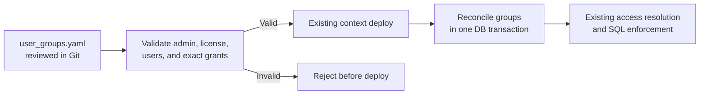
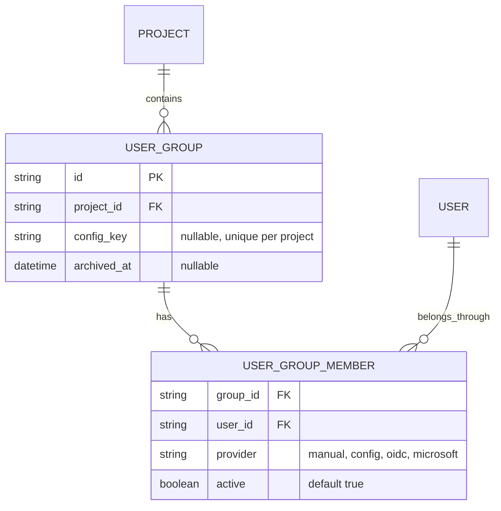

# User Groups as Code

Status: proposed  
Related: [#1809](https://github.com/getnao/nao/issues/1809), [#1800](https://github.com/getnao/nao/issues/1800)

## Decision

Phase 1 adds one optional `user_groups.yaml` file. It manages groups created from that file, their members, and exact schema/table access. `nao deploy` validates and reconciles the file.

Code-managed groups are entirely read-only in the UI. Existing UI and SSO-managed groups remain unchanged and cannot be adopted in Phase 1. No file means leave all groups untouched.



## Deploy

Keep the existing single-request `nao deploy` flow:

1. Extract the uploaded project to the existing temporary directory.
2. If `user_groups.yaml` exists, parse it and validate the actor, license, users, group keys, names, and grants.
3. Reject invalid input before replacing the deployed context.
4. Run the existing context deployment.
5. Reconcile code-managed groups and memberships in one database transaction.
6. Return a short summary of created, updated, deactivated, and unchanged groups.

Do not add plan/confirm endpoints, stale-plan versions, project locks, or a dry-run mode in Phase 1. The filesystem deployment and database transaction are not made atomic with each other; an unexpected infrastructure failure reports the partial deployment and a repeated deploy retries reconciliation.

## Rules

- Stable `key`, mutable `name`.
- Members are normalized emails of existing project users. Unknown or ambiguous emails fail; the deploy does not invite users.
- A code-managed group cannot share a name with an existing UI-managed group.
- Only exact schema and table grants are supported. A schema grant includes future tables in that schema.
- Removing a member deactivates its config membership. Removing a group deactivates the group and all its access without deleting records.
- An empty `groups` list deactivates every code-managed group. A missing file changes nothing.
- Restoring the same key reactivates its group. Changing a key creates a new group and deactivates the old one.
- Deploying the same normalized file twice writes nothing.
- Effective access remains the union of all active groups, including unrelated UI and SSO groups.
- The UI does not write changes back to Git.

## File

```yaml
version: 1

groups:
    - key: finance
      name: Finance
      members:
          - alice@example.com
          - bob@example.com
      database_access:
          mode: restricted
          strict: true
          grants:
              - kind: schema
                database_type: postgres
                database: warehouse
                schema: finance
              - kind: table
                database_type: postgres
                database: warehouse
                schema: shared
                table: exchange_rates
```

Use the existing database-access model after converting YAML snake case to its internal representation. `mode: all` remains available. Restricted access accepts exact grants only in Phase 1.

## Persistence

Extend the existing tables with the minimum ownership and deactivation state. Keep PostgreSQL and SQLite synchronized in one logical migration.



Active config memberships use `provider: config`. Access resolution ignores inactive memberships and archived groups. Archived records remain hidden from normal UI lists but can be restored by key.

## Implementation

1. Add `config_key` and `archived_at` to `user_group`, and `active` plus the `config` provider to `user_group_member`.
2. Add a strict parser for `user_groups.yaml` and map its database access to the existing shared access types.
3. Add one reconciliation service that validates first, then upserts or deactivates config-owned rows in a transaction.
4. Call that service from the existing deploy route after validating against the uploaded context catalog.
5. Mark code-managed groups read-only in the UI and show a “Managed in user_groups.yaml” label.
6. Cover reconciliation and runtime filtering with focused PostgreSQL-compatible and SQLite tests.

## Phase 1 checks

- Missing file preserves all groups; an empty file deactivates only code-managed groups.
- Repeating a deploy writes nothing.
- Only a project admin with the required license can apply the file.
- Invalid YAML, unknown users, name conflicts, and missing exact grants fail before context replacement.
- Keys survive renames and reactivate archived groups.
- Removing members, grants, or groups revokes only code-managed access and preserves all records.
- Existing UI and SSO groups remain unchanged.
- Archived groups and inactive memberships grant no runtime access.
- Strict SQL and agent context use the reconciled access.
- PostgreSQL and SQLite behave the same.

## Deferred

- Adopting existing UI groups or managing individual fields
- Managing the built-in `All Users` group
- Patterns, exclusions, and snapshot expansion from #1800
- SSO mappings, feature settings, sharing, budgets, RLS, and CLS
- Plan/confirm, dry-run, drift detection, audit history, and cross-storage rollback
- Per-group files, repository watchers, invitations, and UI-generated pull requests

Add deferred behavior only after Phase 1 usage proves it is needed.
