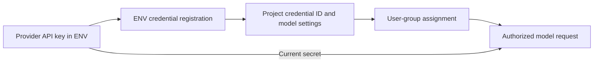

# Group-scoped LLM credentials

Enterprise self-hosted projects can restrict LLM credentials and their models by user group.

## Setup

1. In **Settings → Project → Agent → Models**, review the automatically registered ENV credentials and create any additional named credentials needed for each client or access boundary. Multiple credentials can use the same provider.
2. Open each user group and assign credentials in its **LLM access** tab. Users in multiple groups receive the union of those assignments. Assignments on **All Users** are inherited by every user.
3. Review the activation warnings under **Restrict models by user group**. Resolve users without models, stale assignments, stale defaults, and affected automations as needed.
4. Confirm activation. From that point, model catalogs and execution use only active database credentials assigned through the acting user's effective groups.

The restriction is disabled by default. Environment providers are registered as project credentials with stable IDs, so they can be assigned directly. Their secrets remain in the environment and are read when used. Providers declared only in `nao_config.yaml` still need a named database override before activation.

## Operations

- Rotating an ENV secret takes effect after the backend restarts without changing the credential ID or user-group assignments.
- Removing the ENV configuration makes that credential unavailable. Its record and assignments remain intact, and restoring the environment makes it available again.
- Deactivating an automatically registered ENV credential is an explicit opt-out; startup does not recreate it.
- Membership, SSO mapping, assignment, and credential deactivation changes apply on the next request or automation run.
- Automations and background tasks use their owner or initiating user's effective access.
- Usage records retain the exact credential ID. Administrators can filter usage by active or inactive credential.
- License expiry does not relax an already-enabled restriction. The license controls configuration changes; runtime access remains fail-closed.
- Credential-specific budgets and hard limits are not part of this version. Use a dedicated credential per client group when usage separation is required.

## Recovery and rollback

A user with no active assigned credential cannot run a model. An administrator can restore access by assigning an active credential to one of the user's groups or to **All Users**.

A licensed administrator can switch the project back to project-wide access. This restores the legacy database, YAML, and environment source precedence; it does not delete credentials, group assignments, projects, chats, or usage history.
